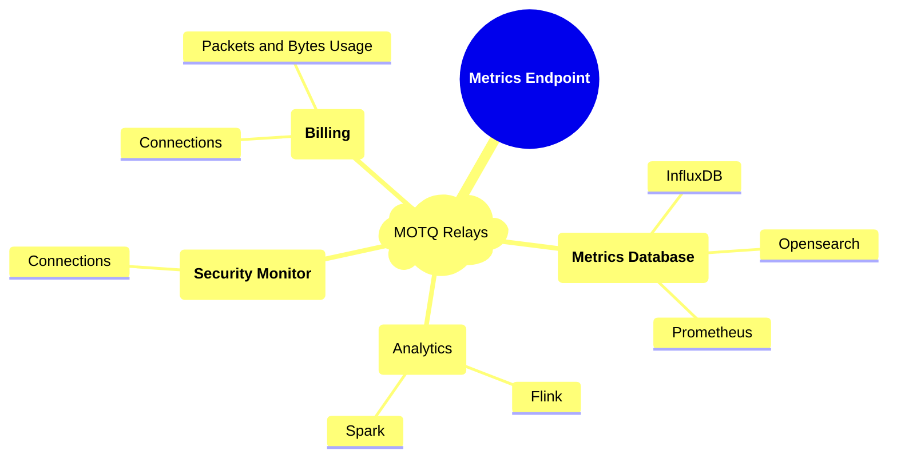

%%%
title = "Metrics over MOQT"
abbrev = "moqt-metrics"
ipr= "trust200902"
area = "art"
workgroup = ""
keyword = ["metrics","moq"]

[seriesInfo]
status = "informational"
name = "Internet-Draft"
value = "draft-jennings-moq-metrics"
stream = "IETF"

[[author]]
initials="C."
surname="Jennings"
fullname="Cullen Jennings"
organization = "Cisco"
[author.address]
email = "fluffy@iii.ca"
[author.address.postal]
country = "Canada"

[[author]]
initials="TE"
surname="Evens"
fullname="Tim Evens"
organization = "Cisco"
[author.address]
email = "tim@evensweb.com"
[author.address.postal]
country = "USA"

[[author]]
initials="S."
surname="Nandakumar"
fullname="Suhas Nandakumar"
organization = "Cisco"
[author.address]
email = "snandaku@cisco.com"
[author.address.postal]
country = "USA"


%%%

# Abstract

Many systems produce significant volumes of metrics that often 
cause congestion with the primary application in low-bandwidth networks.
During congestion or when the network is unavailable, metrics can be lost.
When considering that the application producing metrics may have congestion,
network outage, or be abruptly closed, sending metrics near real-time is
preferred. The challenge with sending metrics near real-time is that
metrics can cause network congestion for the application resulting
in both the application under performing and failing to prioritize 
metrics produced under these conditions.  This document defines how
metrics are produced and consumed using Media over Quic Transport (MOQT)
to overcome metric caused congestion with the ability to prioritize
both metrics and application data. 

# Introduction

Each device that produces metrics publishes the metrics with MoQT. Metrics
are placed into different tracks based on their schema. Each track identifies
a schema so that subscribers can consistently process the schema without
having to detect the schema per received object. 

Traditionally, metrics are attribute/value pairs where the attribute is
the metric name and value is the value of the metric.  Popular metric
collectors use a very basic metric data model that conveys metric
name/value and associated labels that maybe used for searching, such
as a dimension. This data model works well for metrics being consumed
by a simple time series database, but it does not address other metric
subscriber use-cases.  



Other use-cases may require additional attributes that identify actions,
filters, labels, geographic coordinates, ... 

## Security

Subscriber services are often operated by a different teams or company that
is different than the team responsible for the metrics endpoint. 

## Track Namespace and Names

{{!MOQT, Section 5.2}} defines that track namespace will be used by relays
to route objects to subscribers. Track name provides per stream forwarding
and subscription filtering of published objects to a namespace. 


### Track Namespace

Track namespaces identifies metrics being produced by a source

~~~
Namespace {
  prefix (i),
  targetId (i),
  collectionId (i),
  sourceKindId (i),
  sourceId (b), 
}
~~~

* **prefix** uniquely identifies namespace is for metrics
* **targetId** user-defined id to indicate the target where metrics are to be
               collected, such as a region id. AKA scope
* **collectionId** is user-defined collection ID that identifies a high level
                 collection set of metrics (e.g., media10x, webex calling, webex meetings)
                 Map to some well known set, such as appid/otel 
* **sourceKindId** is a user-defined kind ID of device that is producing the metrics
                (e.g., m10x-client, m10x-studio, mcu, sfu)
* **sourceId** user-defined unique source Id sending the metrics, can be device or user scoped ID

### Track Name

Track name identifies a producer of data. The namespace is encoded as:

~~~
Name {
  version (i),
  schemaId (i)
}
~~~

* **version**  Version of the data model used. This specification defines version 1.

> [!NOTE] Need to check into track names for upgrades

### Wildcards

MOQT doesn't support wildcards and a namespace needs to be scoped to a source (e.g., sourceId)

Need some level of discovery. 

## Transmission Mode

Stream per track

## Data Model and Base Schema

### Group Id

Group ID is time. Time is represented by an integer with number of microseconds since "1
Jan 1972" using NTP Era zero conventions.
Group ID increments for every object.

Time supports going back in time to get metrics it also solves a problem with the same
source Id starting over (e.g., application restart).

### Object Id

Object increments for each message/metric

#### Serialization / Deserialization 

JSON vs Avro vs Protobufs / custom TLV based 

The message encoding is JSON. Serialization of JSON is a selection for implementation,
which can be identified using track name `typeId`.   

#### Required Serialization

Several serializations can be used, such as Avro, CBOR, protobufs, TSV/CSV,
custom TLV, etc. This specification requires that atleast JSON lines
serialization is supported. JSON lines serialization is used for its
simplicity and streaming nature. 

JSON lines are serialized as follows:

* Metrics Schema is encoded using a JSON object 
* JSON objects are encoded by stripping whitespaces, tabs, and newlines to
  form a compact JSON line
* One or more objects can be serialized using a newline (`\r\n`) as
  the delimiter between objects
* The presence of a newline (`\r\n`) suggests another object to follow

### Batching and Compression 

### Schema

lengths?? ranges ??? enum???

int vs uint has been a problem in the past with schemas. 

* timestamp (ts) - unix time of the measurement  
* timestamp precision (tp) - Timestamp value precision 
* attribute_type (at) - Attribute type is optional. If not specified it is type **label**  
* attribute_name (an) - Name of the attribute. 
* attr_value (av) - Attribute value is optional. If the value is null, then the name is the value.
* metric_name (mn) - Name of the metric
* metric_value (mv) - The value of the metric/sample
* metric_type (mt)- Datatype, which can be gauge32, guage64, counter32, counter64, uint64, ipv4, ...

#### Timestamp

Timestamp is a 64bit unsigned integer value of time from Jan 1, 1970. 

Timestamp precision specifies the value as seconds (s), milliseconds (m),
microseconds (u), or nanoseconds (n). 

#### Attribute Types

| Type Long Name          | Type Short Name | Value Data Type | Details                                                                                           |
|-------------------------|-----------------|-----------------|---------------------------------------------------------------------------------------------------|
| label                   | l               | string          | Searchable string for the metrics. This would map to `tag` in InfluxDB and `label` in  Prometheus |
| influx_measurement_name | imn             | string          | InfluxDB measurement name                                                                         |

#### JSON Schema

Version 1.

```json
{
    
    "ts": 12234,
    "tp": "<precision>",
    "attrs": [
      {
        "<name>" : "<value>",
        "at": "label"
      }
    ],
    "metrics": [
      {
        "mn": "<string>",
        "mt": "<datatype>",
        "mv": <value>
      }
    ]
}
```

#### JSON Example

##### JSON pretty print
```json
{
  "ts": 1715811793881,
  "tp": "m",
  "attrs": [
    { 
      "at": "imn",
      "an": "m10x-connection"
    },
    {
      "endpoint_id" : "tim@cisco.com"
    },
    {
      "an": "relay_the_name",
      "av": "local-pi-abc123"
    },
    {
      "an": "source",
      "av": "client"
    },
    {
      "an": "connection_id",
      "av": "11007afc02289e77"
    }
  ],
  "metrics": [
    {
      "mn": "tx_retransmits",
      "mt": "counter64",
      "mv": 28
    },
    {
      "mn": "tx_rate_bps_min",
      "mt": "gauge64",
      "mv": 1000
    },
    {
      "mn": "tx_rate_bps_max",
      "mt": "gauge64",
      "mv": 3000
    },
    {
      "mn": "tx_rate_bps_avg",
      "mt": "gauge64",
      "mv": 2000
    }
  ]
}

{
  "ts": 1715812331305,
  "tp": "m",
  "cn": "m10x-connection",
  "dims": [
    {
      "dn": "endpoint_id",
      "dv": "tim@cisco.com"
    },
    {
      "dn": "relay_id",
      "dv": "local-pi-abc123"
    },
    {
      "dn": "source",
      "dv": "client"
    },
    {
      "dn": "connection_id",
      "dv": "11007afc02289e77"
    }
  ],
  "metrics": [
    {
      "mn": "tx_retransmits",
      "mt": "counter64",
      "mv": 49
    },
    {
      "mn": "tx_rate_bps_min",
      "mt": "gauge64",
      "mv": 1200
    },
    {
      "mn": "tx_rate_bps_max",
      "mt": "gauge64",
      "mv": 9000
    },
    {
      "mn": "tx_rate_bps_avg",
      "mt": "gauge64",
      "mv": 1800
    }
  ]
}
```

##### JSON serialized

```
{"ts":1715811793881,"tp":"m","cn":"m10x-connection","dims":[{"dn":"endpoint_id","dv":"tim@cisco.com"},{"dn":"relay_id","dv":"local-pi-abc123"},{"dn":"source","dv":"client"},{"dn":"connection_id","dv":"11007afc02289e77"}],"metrics":[{"mn":"tx_retransmits","mt":"counter64","mv":28},{"mn":"tx_rate_bps_min","mt":"gauge64","mv":1000},{"mn":"tx_rate_bps_max","mt":"gauge64","mv":3000},{"mn":"tx_rate_bps_avg","mt":"gauge64","mv":2000}]}
{"ts":1715812331305,"tp":"m","cn":"m10x-connection","dims":[{"dn":"endpoint_id","dv":"tim@cisco.com"},{"dn":"relay_id","dv":"local-pi-abc123"},{"dn":"source","dv":"client"},{"dn":"connection_id","dv":"11007afc02289e77"}],"metrics":[{"mn":"tx_retransmits","mt":"counter64","mv":49},{"mn":"tx_rate_bps_min","mt":"gauge64","mv":1200},{"mn":"tx_rate_bps_max","mt":"gauge64","mv":9000},{"mn":"tx_rate_bps_avg","mt":"gauge64","mv":1800}]}
```

##### Well known attribute

Type | Name         | Value  | Details 
---- |--------------|--------| -------
tag | name for tag | string | Always a string value  

---

Every source publish an info ID before metrics. The sourceId is used to correlate info
to track (namespace/name). 


# Data Model

A metric time series consists of series of points in time. At each point
in time there can be several measurements as well as several
attributes. Each measurement has a name and value and optional type of
gauge or counter along with an optional unit.

timestamp: time measurement in metric was made

measurement_name, measurement_value: The value is an integer or float
representing counter or gauge. Can have an optional type
measurement_type that is gauge or value. Can have optional
measurement_unit.


### Device ID

Each device that creates logs has a unique deviceID. This is created by
taking the MAC address of the primary network interface in binary,
computing the sha1 hash of it, and truncating to lower 64 bits. Note the
sha1 does not provide any security priories, it is just a hash that is
widely implemented in hardware. If this is not possible, any other
random stable 64 bit identifier may be used. The advantage of us MAC
address is that many other management systems use this address and it
makes it easier to correlate. The disadvantage is that it reveals the
MAC address.

### Time

Time is represented by an integer with number of microseconds since "1
Jan 1972" using NTP Era zero conventions.

# Mapping to MoQ Objects

At each point in time, on object with just the timestamp is written to
group 0. The object id is the time truncated to 62 bit integer. At the
same time an object with all the attributes is written to group 1 with
the same groupID. Each measurement is written to it's own object and the
groupID is formed by the last 16 bits of the sha1 hash of the metric
name.


# Naming

The Namespace used is "moq://mnetrics.moq.arpa/metrics-v1/"

The Track name used is the binary deviceID 


# Data Encoding

### Group 0 

TBD Binary Encoding of:

### Group 1

### Group N


